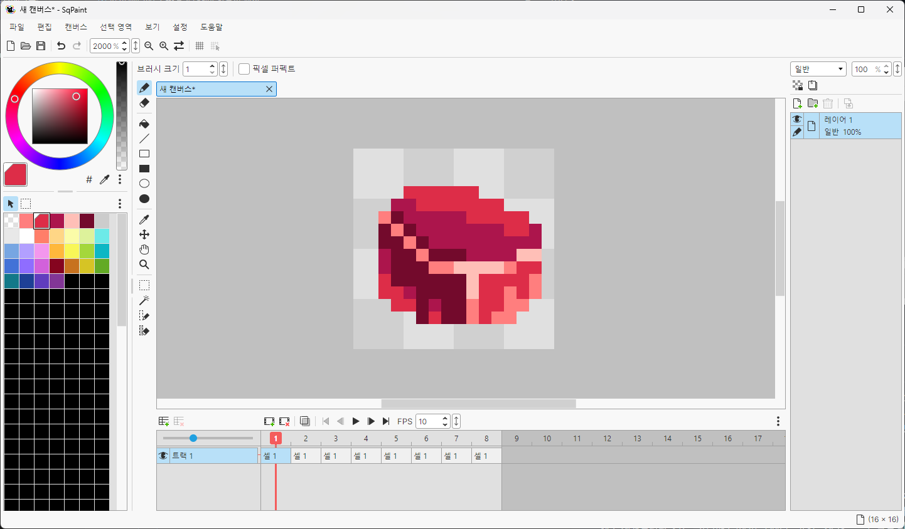

# SqPaint 한국어 패치

일본 1인 개발 인디 픽셀아트 프로그램 [SqPaint](https://nezutako.com/works/tools/sq-paint/)의 한국어 패치

## 한국어 패치 사용 방법
1. [Realese](https://github.com/DominoKorean/sq-paint-ko/releases) 또는 상단의 녹색 `Code` 버튼에서 zip를 다운로드합니다.
2. Apply-Korean.cmd를 실행한 후 SqPaint의 폴더(exe 파일이 들어있는 폴더)를 선택합니다.
3. 선택했던 폴더에서 새로 생긴 SqPaint-Korean.cmd를 실행하면 한국어 패치 파일이 열립니다.

## 버그 리포트
버그 리포트및 건의 사항 등은 [Issues](https://github.com/DominoKorean/sq-paint-ko/issues)에 작성해주세요.

 
 

---

## 번역 작업

이 도구는 SQ Paint 0.9.0 Windows 64비트 빌드에서 메뉴, 도구 설명, 대화상자 등 내장 문자열 375개를 추출합니다. 작업할 때는 `SqPaint.exe`와 `data` 폴더가 함께 들어 있는 원본 폴더를 선택하세요. 도구가 `data/SqPaint.exe`의 SHA-256을 확인하므로, 같은 버전으로 표시되더라도 실행 파일이 다른 빌드는 적용 대상에서 제외됩니다.

### 1. 원문 추출

`Export-Strings.cmd`를 더블클릭하고 원본 SQ Paint 폴더를 선택하면 패치 도구 폴더에 `strings.local.json`이 생성됩니다. 공개용 `translations.ko.json`에 저장된 번역이 있다면 새 작업 파일에도 채워집니다. 기존 `strings.local.json`은 덮어쓰지 않으므로 작업 파일이 이미 있으면 그 파일을 열어 계속 편집하세요.

### 2. 번역 편집

텍스트 편집기에서 `strings.local.json`을 열고 각 항목의 `ko` 값을 수정한 뒤 UTF-8로 저장하세요.

~~~json
{
  "key": "Main_Header_File",
  "group": "Main",
  "en": "File",
  "ja": "ファイル",
  "ko": "파일"
}
~~~

- `key`는 SQ Paint가 문자열을 찾는 데 사용합니다. 키 이름은 그대로 두세요.
- 짧은 UI 문구는 두 원문과 화면 위치를 함께 참고하고, 긴 안내문은 일본어 원문인 `ja`를 기준으로 번역합니다.
- `{0}`, `{1}` 같은 자리표시자는 유지하세요. 줄바꿈에는 `\n`, 문구 안의 큰따옴표에는 `\"`를 사용합니다.
- `ko`가 빈 문자열이면 해당 항목에는 앱에서 선택한 언어의 원문이 표시됩니다.

### 3. 번역 적용 및 확인

`Apply-Korean.cmd`를 더블클릭하고 원본 SQ Paint 폴더를 선택하세요. 도구는 배치 파일 옆의 `strings.local.json`을 우선 읽고, 없으면 같은 위치의 `translations.ko.json`을 읽습니다. 선택한 SQ Paint 폴더에 생성되는 `SqPaint-Korean.cmd`를 파일 탐색기에서 실행해 메뉴, 도구 설명, 대화상자를 확인하세요.

번역한 문구는 앱의 English와 日本語 설정 모두에서 표시됩니다. 수정한 내용을 다시 확인하려면 패치판을 종료한 뒤 `Apply-Korean.cmd`를 다시 실행하세요.

### 4. 공개용 번역 파일 갱신

패치 도구 폴더에서 PowerShell을 열고 아래 명령을 실행한 뒤 원본 SQ Paint 폴더를 선택하세요.

~~~powershell
powershell.exe -NoProfile -STA -ExecutionPolicy Bypass -File .\SqPaint-Korean.ps1 -Mode SaveTranslations
~~~

이 명령은 `strings.local.json`에서 `key`와 `ko`만 가져와 `translations.ko.json`을 갱신합니다. GitHub 배포본에는 README, 스크립트, 공개용 번역 JSON을 담으세요. SQ Paint 원본 폴더, 생성된 실행 파일, 영문과 일문 원문이 담긴 `strings.local.json`은 로컬에 보관합니다.

## Using the tool for other languages

The same scripts can apply translations for other languages to the supported Windows x64 build of SQ Paint 0.9.0. Run the commands below in PowerShell from the patch tool folder. Replace the example path with the folder containing your own copy of SQ Paint. Use a separate copy for each language you want to test side by side, since the output filenames are fixed.

### 1. Export a blank catalog

This example uses French. Create a new file named `translations.fr.json` containing just `[]`, then run the export command. The empty file lets you start with a blank translation catalog.

~~~powershell
$app = 'C:\Apps\sq-paint_v0.9.0'
powershell.exe -NoProfile -ExecutionPolicy Bypass -File .\SqPaint-Korean.ps1 -Mode Export -AppFolder $app -Catalog .\strings.fr.local.json -Translations .\translations.fr.json
~~~

### 2. Translate and apply

Open `strings.fr.local.json` in a text editor. Use the English (`en`) and Japanese (`ja`) strings as references. For longer messages, use Japanese as the source text. Put the translation in the `ko` field even when the target language is French or another language. The script uses that field to read translations. Keep each `key` and any placeholders such as `{0}` and `{1}`, and save the file as UTF-8.

~~~powershell
powershell.exe -NoProfile -ExecutionPolicy Bypass -File .\SqPaint-Korean.ps1 -Mode Apply -AppFolder $app -Catalog .\strings.fr.local.json
~~~

In File Explorer, open the SQ Paint folder and double-click the generated `SqPaint-Korean.cmd`. It launches `data\SqPaint.Korean.exe`. The tool uses these filenames for every target language. Translated strings appear under both the English and Japanese settings, and blank entries fall back to the selected language. The patch uses the existing language settings and does not add a language menu entry.

### 3. Save a translation file for distribution

~~~powershell
powershell.exe -NoProfile -ExecutionPolicy Bypass -File .\SqPaint-Korean.ps1 -Mode SaveTranslations -AppFolder $app -Catalog .\strings.fr.local.json -Translations .\translations.fr.json
~~~

This updates `translations.fr.json` with only the string keys and your translations. Share that JSON and the patch script. Recipients should supply their own compatible copy of SQ Paint and pass `-Catalog .\translations.fr.json` to the apply command.

## 지원 범위 / Scope

이 도구는 내장 문자열 리소스를 수정합니다. 이미지에 포함된 글자와 실행 코드에 직접 들어 있는 문구는 추출 대상에서 빠집니다.

The tool patches embedded string resources. Text baked into images or hard-coded outside those resources is outside its scope.
